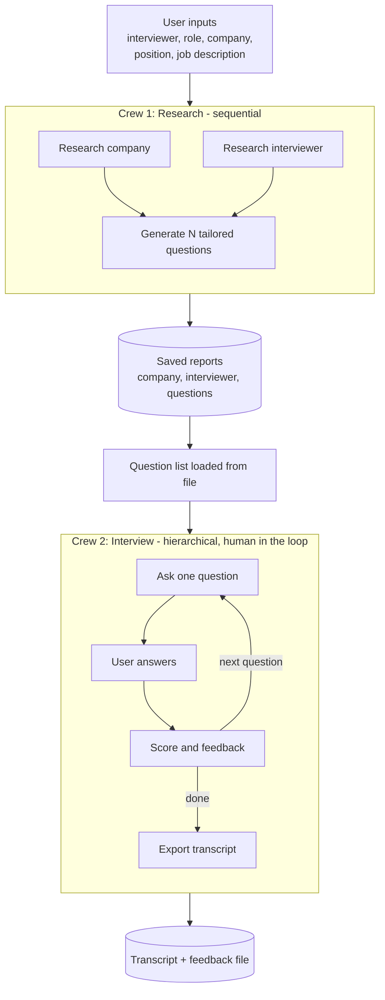

# AI Agent Interview Coach


[](LICENSE)

[](https://colab.research.google.com/github/vjabarca/AI-Agent-Interview-Coach/blob/main/AI_Agent_Interview_Coach.ipynb)

A multi-agent [CrewAI](https://www.crewai.com/) workflow that helps you prepare for a specific job interview. It researches the company and your interviewer, writes interview questions tailored to the role, then runs an interactive mock interview where it asks you each question, waits for your answer, scores it, and saves a transcript with feedback.

## Table of Contents

- [Overview](#overview)
- [How It Works](#how-it-works)
- [Example Output Format](#example-output-format)
- [Tech Stack](#tech-stack)
- [Installation](#installation)
- [Configuration](#configuration)
- [Usage](#usage)
- [Responsible Use](#responsible-use)
- [Project Structure](#project-structure)
- [Known Issues & Limitations](#known-issues--limitations)
- [Roadmap](#roadmap)
- [Contributing](#contributing)
- [License](#license)
- [Author & Support](#author--support)
- [Acknowledgments](#acknowledgments)

## Overview

Generic interview question lists don't reflect the company you're interviewing with, the job description, or the person across the table. This project automates that preparation in two stages:

1. **Research crew:** gathers background on the company and the interviewer from the web, then generates a set of tailored questions with a rationale for each.
2. **Interview crew:** plays the interviewer, asks the questions one at a time, collects your answers, gives structured feedback (score, strengths, improvements), and exports the full session to a file.

## How It Works



| Agent | Role | Tools |
|---|---|---|
| Research Agent | Researches the company and the interviewer | `SerperDevTool` (web search), `ScrapeWebsiteTool` |
| Question Agent | Interview coach persona that writes the tailored questions | none |
| Interviewer Agent | Asks the questions, evaluates answers, writes the transcript | none |

| Task | Output |
|---|---|
| Research company | Overview, leadership, products, recent news, competitors (with sources) |
| Research interviewer | Dossier: background, interests, recent activity, icebreakers, tailored advice |
| Define questions | N questions, each with `number`, `question`, `category`, and `strategic_rationale` |
| Interview | Question-by-question dialogue, pausing for your answer each time |
| Feedback | Score, strengths, areas for improvement, and how to take the answer further |
| File export | Markdown transcript written to the output file you name |

The interview crew uses CrewAI's hierarchical process with a manager model, memory, and planning enabled, and `human_in_the_loop=True` on the interview task so the run pauses for your input.

## Example Output Format

The structure below is illustrative (placeholder content, not a real run).

**Generated question:**

```json
{
  "number": 1,
  "question": "Describe a time you designed a system where reliability was critical. What trade-offs did you make?",
  "category": "Technical - System Design & Reliability",
  "strategic_rationale": "Tests experience with the kind of high-ownership engineering the job description emphasizes."
}
```

**Feedback after each answer:**

```markdown
### Question 1
**Score: 7.5 / 10**

**Strengths**
- Clear structure (situation, action, result)
- Professional and confident tone

**Areas for improvement**
- Add concrete metrics (latency, uptime, cost)
- Explain what you would do differently

**Taking it to the next level**
- Open with the result, then walk through the decision
```

**Files written to the working folder:**

| File | Contents |
|---|---|
| `<company>_report.txt` | Company research |
| `<interviewer>_report.txt` | Interviewer dossier |
| `<job position>_report.txt` | Generated questions |
| `<output file name>` | Interview transcript with feedback |

## Tech Stack

- **Language:** Python 3
- **Agent framework:** [CrewAI](https://github.com/crewAIInc/crewAI) (`crewai[tools]`)
- **LLM:** OpenAI `gpt-4o` via `langchain_openai` (temperature 0.5)
- **Web search and scraping:** [Serper](https://serper.dev/) and CrewAI's `ScrapeWebsiteTool`
- **Environment:** Jupyter / Google Colab (`nest_asyncio` for async runs in a notebook)

## Installation

### Option A: Google Colab (as the notebook was written)

1. Click the **Open In Colab** badge above.
2. Add your API keys as Colab secrets (see [Configuration](#configuration)).
3. Change the working-directory cell (`%cd ...`) to a folder in your own Google Drive.
4. Run the cells top to bottom.

### Option B: Run locally

```bash
# 1. Clone the repository
git clone https://github.com/vjabarca/AI-Agent-Interview-Coach.git
cd AI-Agent-Interview-Coach

# 2. Create and activate a virtual environment
python -m venv .venv
source .venv/bin/activate        # Windows: .venv\Scripts\activate

# 3. Install dependencies
pip install "crewai[tools]" langchain_openai nest_asyncio jupyter

# 4. Launch the notebook
jupyter notebook AI_Agent_Interview_Coach.ipynb
```

> **Local runs:** the notebook mounts Google Drive and reads keys with `google.colab.userdata`. Both are Colab-only. Remove those cells, delete the `%cd` line (or point it to a local folder), and set the environment variables shown below.

## Configuration

Two API keys are required.

| Variable | Used for | Where to get it |
|---|---|---|
| `OPENAI_API_KEY` | GPT-4o for the agents, manager, and memory | [platform.openai.com](https://platform.openai.com/api-keys) |
| `SERPER_API_KEY` | Google Search for company and interviewer research | [serper.dev](https://serper.dev/) |

**In Colab**, create two secrets (the key icon in the left sidebar) named `ai_agents_openai` and `serper_api`, then enable notebook access. The notebook reads them with:

```python
from google.colab import userdata
os.environ['OPENAI_API_KEY'] = userdata.get('ai_agents_openai')
os.environ['SERPER_API_KEY'] = userdata.get('serper_api')
```

**Locally**, export them in your shell:

```bash
export OPENAI_API_KEY="sk-..."
export SERPER_API_KEY="..."
```

Never commit API keys to the repository.

## Usage

The notebook has two parts. Run the cells in order.

**Part 1: Research crew**

1. Run the setup cells (Drive mount, installs, imports, keys, LLM).
2. Answer the prompts:

   | Prompt | Example |
   |---|---|
   | Interviewer Name (if unknown, enter `None`) | `Jane Doe` |
   | Interviewer Role (if unknown, enter `None`) | `Engineering Manager` |
   | Company Name | `Acme Corp` |
   | Job Position | `Senior Software Engineer` |
   | Job Description | paste the full posting text |

3. Enter the number of questions to generate (for example `3`).
4. Run the research crew:

   ```python
   nest_asyncio.apply()
   result = await crew.kickoff_async({"topic": "Write a list of questions to prepare for the interview"})
   ```

5. Review the results with `display(Markdown(result.raw))`, then run the export cell to save the three reports.

**Part 2: Interview crew**

1. Run the cell that loads the saved question file.
2. Enter the output file name (for example `OUTPUT.txt`).
3. Run the interview crew. When the agent asks a question, type your answer in the input box and press Enter. After each answer you get feedback, then the next question.
4. When the last question is done, the transcript is written to your output file.

Tip: answer as you would in the real interview, using the STAR method (Situation, Task, Action, Result) and concrete numbers.

## Responsible Use

- The interviewer research uses publicly available professional information only. Don't use it to gather private or personal details about anyone.
- LLM-generated research can be wrong or out of date. Verify names, titles, and facts before relying on them in a real interview.
- Treat the feedback as practice guidance, not a prediction of hiring outcomes.
- Notebook outputs may contain real names and job details. Clear them before sharing or committing the notebook.

## Project Structure

```text
.
├── AI_Agent_Interview_Coach.ipynb   # research crew + interview crew
├── LICENSE
└── README.md
```

Files created when you run the notebook (don't commit them): the company, interviewer, and question reports, and the interview transcript.

## Known Issues & Limitations

- **Colab-specific:** Drive mounting, `userdata` secrets, and a hardcoded working directory mean local use needs edits.
- **No resume input:** the coach persona is described as cross-referencing resumes with the job description, but the notebook never asks for a resume, so questions are based only on the company, interviewer, and job description.
- **One agent does two jobs:** the Interviewer Agent both asks the questions and writes the feedback. The coach persona (`question_agent`) is only used to generate the questions.
- **Transcript summarizes answers:** in the recorded run, the transcript described each answer (for example, that you used the STAR method) instead of preserving your exact words.
- **Question format varies:** the question list is requested as "Markdown with keys", and runs have returned JSON-style or YAML-style text, sometimes wrapped in code fences. Downstream steps pass it along as plain text.
- **Redundant step:** the interview crew includes the question-generation task again, so the questions are regenerated at the start of Part 2 and can differ from the saved file.
- **Agents don't set an LLM explicitly:** the `llm` is only passed to the crew and the hierarchical manager, so the agents use CrewAI's default model setup unless you configure it.
- **Unused crew input:** the `{"topic": ...}` dictionary passed to `kickoff_async` isn't referenced by any task.
- **File names come from inputs:** report names use your inputs directly, so an interviewer entered as `None` produces `None_report.txt`, and special characters or spaces appear in file names.
- **Research quality varies:** results depend on what web search and scraping return, and low-profile companies or people may yield thin results.
- **Cost and latency:** each run makes many LLM and search calls, and hierarchical mode with memory and planning adds more.
- **Unpinned dependencies:** versions are not pinned, and CrewAI changes quickly (the notebook already contains workarounds for earlier API changes).

## Roadmap

- [ ] Add a resume input so questions and feedback reference your actual experience
- [ ] Record your answers verbatim in the transcript
- [ ] Use a separate Feedback Agent (the coach persona) instead of the interviewer
- [ ] Return questions as validated structured output (Pydantic) instead of free text
- [ ] Remove the duplicate question-generation task from the interview crew
- [ ] Pass the LLM explicitly to every agent
- [ ] Add a final summary with overall strengths, weaknesses, and a score trend
- [ ] Support follow-up questions based on your answers
- [ ] Make the notebook runnable locally without Colab-specific cells
- [ ] Add a `requirements.txt` with pinned versions
- [ ] Optional lightweight UI (for example Streamlit)

## Contributing

Contributions, bug reports, and feature ideas are welcome.

1. **Report a bug or request a feature:** open an [issue](https://github.com/vjabarca/AI-Agent-Interview-Coach/issues) and include what you expected, what happened, and your environment (Colab or local, CrewAI version).
2. **Submit a change:**
   1. Fork the repository
   2. Create a branch: `git checkout -b feature/your-feature`
   3. Commit your changes with a clear message
   4. Push the branch and open a pull request describing what changed and why

Please clear notebook outputs and make sure no API keys or personal details appear in the notebook before committing.

## License

Distributed under the MIT License. See [`LICENSE`](LICENSE) for details.

## Author & Support

**Victor J. Abarca**, San José, CA

- GitHub: [@vjabarca](https://github.com/vjabarca)

For questions or problems, please open an issue in this repository.

## Acknowledgments

- [CrewAI](https://www.crewai.com/) for the multi-agent framework
- [Serper](https://serper.dev/) for the search API
